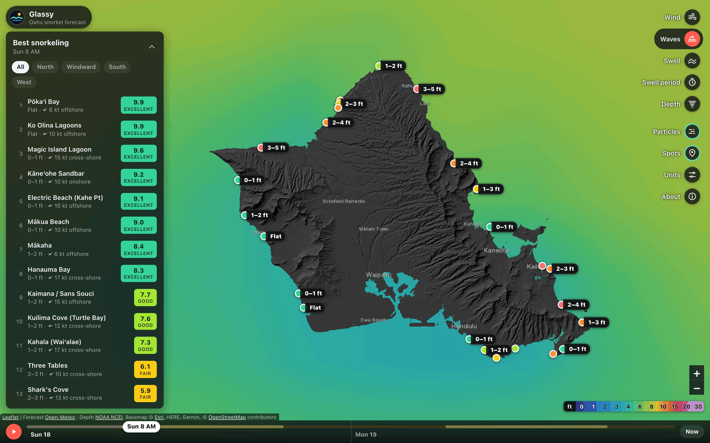
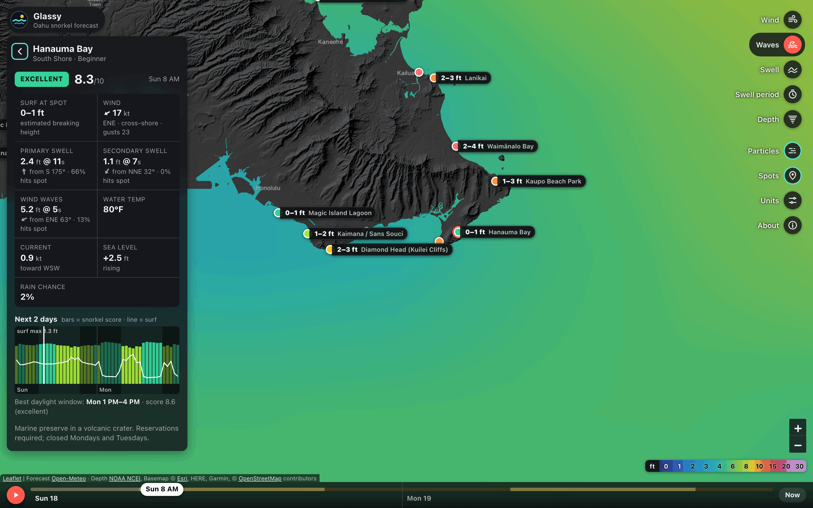
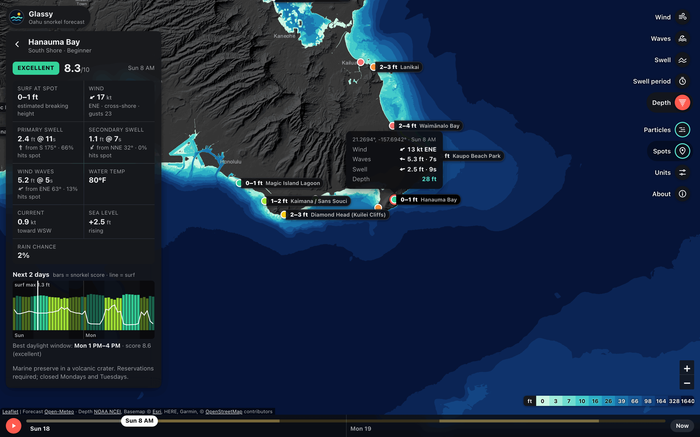
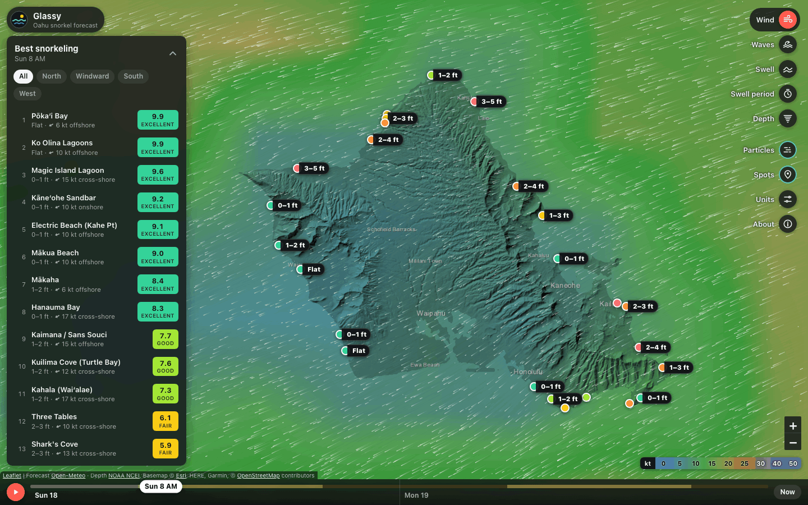
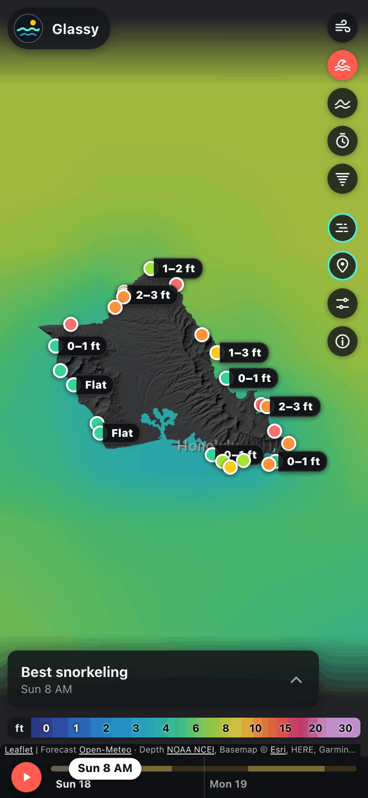
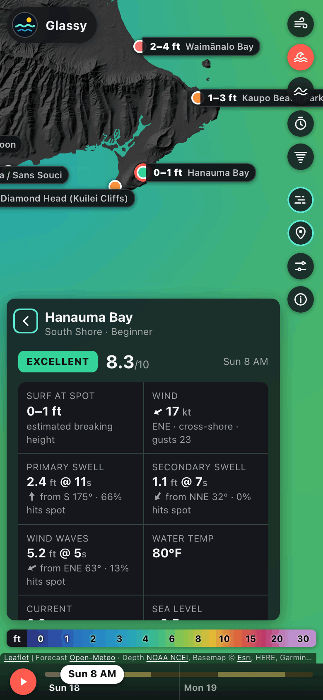
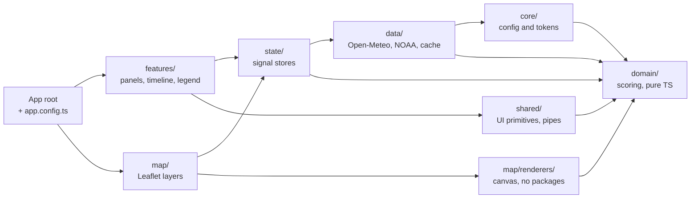

# Glassy

A Windy-style forecast map that ranks Oahu's snorkel spots by wind, swell and depth, hour by hour.

[](https://github.com/jamesablue/glassy/actions/workflows/ci.yml)
[](https://github.com/jamesablue/glassy/actions/workflows/codeql.yml)
[](https://github.com/jamesablue/glassy/actions/workflows/deploy-pages.yml)
[](LICENSE)
[](https://angular.dev)
[](https://www.typescriptlang.org)

**[Live demo](https://jamesablue.github.io/glassy/)** ·
[Architecture](docs/architecture.md) · [Scoring model](docs/scoring-model.md) ·
[Decisions](docs/adr/README.md) · [All docs](docs/README.md)



## Why

Oahu has good snorkeling on every shore, but rarely on all of them at once: a north swell closes
the North Shore while the south shore lies flat, and the trade winds chop up the windward side.
Forecast sites show swell and wind offshore, not what they mean at a particular cove behind a reef.
Glassy turns the public forecast into an estimate of the surf, wind and current at each of 25
spots, scores them, and shows where and when the water should be calm.

## Features

- **Forecast layers:** wind, waves, swell, swell period and depth, each with its legend.
- **Animated particles** that follow the wind, wave or swell direction.
- **Ranked spots** by snorkel score (0 to 10) at the selected hour, filterable by shore, with the
  estimated surf and wind on each row and the surf on each pin.
- **Spot details:** rating, hazard warnings, a conditions grid (surf, wind, each swell and how much
  of it reaches the spot, water temperature, current, sea level, rain), a chart of score and surf
  over the five-day forecast, and the best three-hour daylight window.
- **Timeline** with day and night bands, playback, a Now button and keyboard steps.
- **Tap anywhere** on the map for the wind, waves and swell there, plus the depth (or land height)
  from NOAA.
- **Shareable URLs:** `?spot=hanauma&layer=depth&t=2026-10-20T08` restores the spot, layer and hour.
- **Units:** feet or meters; knots, mph, km/h or m/s; °F or °C. Remembered between visits.
- **Usable when the forecast API is slow:** the ranking appears as soon as the spot forecast
  arrives and the map layers follow; a returning visitor sees the cached forecast at once while it
  refreshes; no request is waited on for more than 25 seconds.
- **Responsive and accessible:** a bottom-sheet layout on phones, full keyboard use (including the
  map and the chart), screen reader announcements, reduced motion, and 0 axe violations.

## Screenshots

<table>
  <tr>
    <td width="50%"><br><sub><b>Spot details</b>: conditions, hazards, the score and surf chart, the best window.</sub></td>
    <td width="50%"><br><sub><b>Depth layer</b> from NOAA, with the readout from a tap in Hanauma Bay.</sub></td>
  </tr>
  <tr>
    <td width="50%"><br><sub><b>Wind layer</b> with particles following the trade winds.</sub></td>
    <td width="50%">
      
      
      <br><sub><b>On a phone</b>: the map with the folded ranking, and a spot's details.</sub>
    </td>
  </tr>
</table>

The screenshots show the recorded forecast the tests use (8 AM on Sunday 18 October 2026) and are
taken by a script, `npm run docs:screenshots`.

## Architecture at a glance



The arrows show the main imports between layers (the full rules are in the architecture doc), and
ESLint fails the build when a file imports from a layer it may not use. `domain/` holds the scoring model and everything it needs as plain TypeScript with no
dependencies; `data/` turns Open-Meteo and NOAA responses into typed arrays; `state/` derives the
ranking, pins and details with signals; `map/` and `features/` only render what the stores hold,
and never import each other. Where a lower layer needs something from a higher one, it depends on
a token in `core/` instead (for example, the map gets NOAA tile URLs through
`TERRAIN_TILE_SOURCES`). [docs/architecture.md](docs/architecture.md) has the system context,
component tree, startup sequence, state map and rendering pipeline.

## Tech stack

| Choice                                        | Why                                                                                                                                                                                     |
| --------------------------------------------- | --------------------------------------------------------------------------------------------------------------------------------------------------------------------------------------- |
| **Angular 22**, standalone, zoneless, signals | Signal inputs, `computed` and `rxResource` update only what changed, without Zone.js. `@defer` keeps the spot details and About text out of the initial bundle.                         |
| **Signal stores** instead of NgRx             | Small state, fine-grained derivations, tested through a public API ([ADR-0003](docs/adr/0003-signal-stores-over-ngrx.md)).                                                              |
| **Leaflet 1.9** with custom canvas renderers  | Raster tiles from Esri and NOAA, plus a forecast field and particles drawn by framework-free classes that are unit-tested ([ADR-0002](docs/adr/0002-leaflet-with-canvas-renderers.md)). |
| **IndexedDB** (`idb-keyval`)                  | Caches the typed-array forecast as it is: no requests for 45 minutes, a stale fallback for 12 hours ([ADR-0005](docs/adr/0005-indexeddb-forecast-cache.md)).                            |
| **Vitest** with Angular TestBed and jsdom     | The Angular 22 default runner; fast domain tests with per-layer coverage floors.                                                                                                        |
| **Playwright** and **axe-core**               | End-to-end, accessibility and visual tests against the production build, offline on a recorded forecast ([ADR-0006](docs/adr/0006-vitest-playwright-recorded-fixtures.md)).             |
| **AWS CDK** v2 with cdk-nag                   | S3 and CloudFront with security headers and an OIDC deploy role, tested and synthesized in CI ([ADR-0007](docs/adr/0007-dual-hosting-pages-and-aws.md)).                                |
| **GitHub Actions**                            | Parallel CI jobs, SHA-pinned actions, CodeQL, Dependabot, and a Pages deploy after green CI.                                                                                            |
| **TypeScript 6**, strict                      | Plus `noUncheckedIndexedAccess` and `exactOptionalPropertyTypes`.                                                                                                                       |

## Engineering highlights

- **Scoring parity with the prototype.** A golden test scores a real recorded forecast and
  compares it with a verbatim copy of the original prototype's code: all 1,200 spot-hours (25 spots
  × 48 hours) match exactly, and so does the ranking at every hour.
- **Tests.** 1,118 unit and component tests, 116 end-to-end tests on a desktop and a Pixel 7, and 5
  screenshot comparisons, all offline. Coverage per layer (statements / branches / functions /
  lines), each held to a floor in CI:

  | Layer       | Coverage                  | Floor |
  | ----------- | ------------------------- | ----: |
  | `domain/`   | 100 / 98.5 / 100 / 100    |   95% |
  | `data/`     | 100 / 98.6 / 100 / 100    |   90% |
  | `state/`    | 100 / 98.6 / 100 / 100    |   90% |
  | `shared/`   | 100 / 99.4 / 100 / 100    |   90% |
  | `features/` | 98.2 / 98.3 / 96.5 / 99.8 |   85% |
  | `map/`      | 99.5 / 98.3 / 98.6 / 99.8 |   80% |
  | `core/`     | 100 / 93.5 / 100 / 100    |     – |

- **Accessibility.** 0 axe violations (WCAG 2.0 to 2.2, A and AA, plus best practices) in 10 states
  on a desktop and a phone. The one narrowed rule, target size, exempts only the map pins, whose
  action is also a full-size row in the ranking.
- **Lighthouse** (13.5, production build served locally, median of 3 runs):

  |         | Performance | Accessibility | Best Practices | SEO |
  | ------- | ----------: | ------------: | -------------: | --: |
  | Desktop |          99 |            96 |            100 | 100 |
  | Mobile  |          93 |            96 |             96 | 100 |

  Accessibility loses points for the overlapping pins at island-wide zoom (above), and mobile Best
  Practices for Esri's 256 px basemap tiles on a high-density screen.

- **Bundle.** 483.7 kB initial (133.0 kB transferred), under a 510 kB warning and 535 kB error
  budget. Leaflet is about 150 kB of it. Removing `@angular/router` saved 69.6 kB
  ([ADR-0008](docs/adr/0008-url-state-without-the-router.md)).
- **Rendering.** The forecast field paints at 1/3 resolution and only on change. In a trace of ten
  map pans, no task with app script in it ran longer than 10 ms; idling repaints nothing.
- **Lint-enforced layers.** ESLint rejects imports across layer boundaries, keeps `domain/` and
  `map/renderers/` free of every package, and makes every end-to-end spec use the offline fixture.
- **Supply chain.** Every GitHub Action is pinned to a commit SHA, each job gets least-privilege
  permissions, actionlint checks the workflows, and CodeQL runs on every pull request. The CI jobs
  run in parallel in about two and a half minutes.

## Getting started

Requires Node 24 (see `.nvmrc`).

```sh
nvm use && npm ci && npm start
```

Then open http://localhost:4200. The dev server calls the live Open-Meteo, NOAA and Esri services.

| Script                      | What it does                                                         |
| --------------------------- | -------------------------------------------------------------------- |
| `npm start`                 | Dev server on port 4200                                              |
| `npm run build`             | Production build (base href `/`), checked against the bundle budgets |
| `npm run build:pages`       | GitHub Pages build (base href `/glassy/`)                            |
| `npm run watch`             | Development build that rebuilds on change                            |
| `npm test`                  | Unit and component tests (Vitest), single run                        |
| `npm run test:watch`        | The same, in watch mode                                              |
| `npm run test:ci`           | Unit tests with coverage, failing below each layer's floor           |
| `npm run lint`              | ESLint, including the layer import boundaries                        |
| `npm run typecheck`         | TypeScript for the app, unit tests, end-to-end tests and scripts     |
| `npm run format`            | Prettier, rewriting files                                            |
| `npm run format:check`      | Prettier check                                                       |
| `npm run e2e`               | Playwright end-to-end tests, offline on the recorded forecast        |
| `npm run e2e:visual`        | Screenshot comparisons in the Playwright Linux image (needs Docker)  |
| `npm run e2e:visual:update` | Takes new screenshot baselines the same way                          |
| `npm run fixtures:record`   | Records the forecast fixtures again from the live APIs               |
| `npm run fixtures:expected` | Scores the recorded fixtures with the original prototype's code      |
| `npm run docs:screenshots`  | Builds the app and captures the README images in `docs/images/`      |
| `npm run ng`                | The Angular CLI (`npm run ng -- <command>`)                          |
| `npm run prepare`           | Installs the Git hooks (Husky); runs by itself after `npm ci`        |

[CONTRIBUTING.md](CONTRIBUTING.md) covers branches, commits and what a pull request needs.

## Project structure

```text
glassy/
├─ src/app/
│  ├─ domain/      scoring model, grid sampling, palettes, units, time, spot catalog (pure TS)
│  ├─ data/        Open-Meteo and NOAA clients, adapter to typed arrays, IndexedDB cache
│  ├─ state/       signal stores and URL sync
│  ├─ map/         Leaflet host, layer components, framework-free canvas renderers
│  ├─ features/    shell, ranking, spot details, timeline, layer menu, legend, popovers
│  ├─ shared/      UI primitives and unit pipes
│  └─ core/        config, injection tokens, error handler, notices
├─ src/styles/     design tokens and Leaflet overrides
├─ src/testing/    test helpers and the recorded forecast fixtures
├─ e2e/            Playwright specs and their offline support code
├─ scripts/        fixture recorder, expected scores, screenshots, CI summaries
├─ infra/          AWS CDK app (its own package)
├─ docs/           architecture, scoring model, testing, deployment, ADRs, images
└─ .github/        CI, CodeQL, deploy workflows, Dependabot, templates
```

Each folder in `src/app/` has a README with what lives there and what it may import.

## Data sources and attribution

| Source                                                                                          | Used for                                                                               | Terms                                                                                      |
| ----------------------------------------------------------------------------------------------- | -------------------------------------------------------------------------------------- | ------------------------------------------------------------------------------------------ |
| [Open-Meteo](https://open-meteo.com) Marine and Forecast APIs                                   | waves, swell, currents, sea temperature, sea level; wind, gusts, rain chance, daylight | data under [CC BY 4.0](https://open-meteo.com/en/licence); free API for non-commercial use |
| [NOAA NCEI](https://www.ncei.noaa.gov/products/coastal-elevation-models) DEM mosaic ImageServer | land hillshade and depth tiles, depth at a tapped point                                | U.S. government data, credited to NOAA NCEI                                                |
| [Esri](https://www.esri.com) World Dark Gray Canvas                                             | basemap and place names                                                                | credited "Esri, HERE, Garmin, © OpenStreetMap contributors"                                |
| [OpenStreetMap](https://www.openstreetmap.org/copyright) contributors                           | map data inside the Esri basemap                                                       | [ODbL](https://www.openstreetmap.org/copyright)                                            |

The requests do not pin a forecast model, so Open-Meteo uses its best match for each location; the
About panel credits the ECMWF, Météo-France and NOAA GFS models. The map's attribution line and the
About panel carry the credits above.

**Rate limits and caching.** Open-Meteo's free tier allows 600 calls a minute, 5,000 an hour and
10,000 a day per IP, and a load is four requests. Glassy keeps the last forecast in IndexedDB: a
reload within 45 minutes sends none, and a copy up to 12 hours old is shown at once while it
refreshes, and kept, with its age, if the refresh fails. A 429 gets its own "try again in a minute"
message, and a request that takes more than 25 seconds is abandoned rather than retried. NOAA depth lookups are
remembered for the last 256 points, map tiles use the browser's HTTP cache, and a tile source that
fails six times in a row is paused for 30 seconds.

## How the snorkel score works

1. Each wave train (primary swell, secondary swell, wind waves) is scaled by how squarely it hits
   the spot's shore and by its period, since long-period swell breaks bigger.
2. The trains combine by energy (root of the sum of squares), and the spot's shelter takes its
   share off: that is the estimated surf at the spot.
3. Wind counts fully when onshore and much less when offshore, reduced by shelter.
4. The score starts at 10 and loses points for surf, wind and current from piecewise-linear tables.
5. Bands: Excellent 8+, Good 6.5+, Fair 5+, Poor 3+, Hazardous below 3; hazards and the best
   daylight window come from the same numbers.

[docs/scoring-model.md](docs/scoring-model.md) has every formula and table, a worked example and the
model's known limitations. It is an estimate: check lifeguard postings and the water before going
in.

## Testing

Unit and component tests (Vitest), end-to-end and accessibility tests (Playwright and axe) and
visual regression all run offline against one recorded forecast, with the clock pinned to the
morning of the recording. [docs/testing.md](docs/testing.md) explains each level, the coverage
floors, the golden test and how to re-record the fixtures; [e2e/README.md](e2e/README.md) covers
the end-to-end support code.

## Deployment

- **GitHub Pages** hosts the [live demo](https://jamesablue.github.io/glassy/). It deploys after CI
  passes on `main`.
- **AWS S3 + CloudFront** is defined with the CDK in [`infra/`](infra/), tested in CI and deployed
  by hand through GitHub OIDC.

[docs/deployment.md](docs/deployment.md) has both runbooks; [infra/README.md](infra/README.md) has
the AWS details.

## Decisions

The main trade-offs are written up as [architecture decision records](docs/adr/README.md):

| ADR                                                          | Decision                                          |
| ------------------------------------------------------------ | ------------------------------------------------- |
| [0001](docs/adr/0001-static-spa-no-backend.md)               | A static SPA with no backend                      |
| [0002](docs/adr/0002-leaflet-with-canvas-renderers.md)       | Leaflet with custom canvas renderers              |
| [0003](docs/adr/0003-signal-stores-over-ngrx.md)             | Signal stores instead of NgRx                     |
| [0004](docs/adr/0004-heuristic-surf-and-snorkel-score.md)    | A heuristic surf estimate and snorkel score       |
| [0005](docs/adr/0005-indexeddb-forecast-cache.md)            | An IndexedDB forecast cache with a stale fallback |
| [0006](docs/adr/0006-vitest-playwright-recorded-fixtures.md) | Vitest and Playwright on recorded fixtures        |
| [0007](docs/adr/0007-dual-hosting-pages-and-aws.md)          | Dual hosting on GitHub Pages and AWS              |
| [0008](docs/adr/0008-url-state-without-the-router.md)        | URL state without the Angular router              |
| [0009](docs/adr/0009-native-popover-api.md)                  | The native Popover API instead of CDK Overlay     |

## Roadmap

Ideas beyond v1.0 are in the [Backlog milestone](https://github.com/jamesablue/glassy/milestone/4):

- [#12](https://github.com/jamesablue/glassy/issues/12) Web Worker / OffscreenCanvas field rendering
- [#13](https://github.com/jamesablue/glassy/issues/13) PWA offline mode
- [#14](https://github.com/jamesablue/glassy/issues/14) Freediving mode (depth and visibility first)
- [#15](https://github.com/jamesablue/glassy/issues/15) More islands via `SPOT_CATALOG`
- [#16](https://github.com/jamesablue/glassy/issues/16) NOAA CO-OPS tide station data
- [#17](https://github.com/jamesablue/glassy/issues/17) Forecast proxy and cache (Cloudflare Worker or Lambda) for rate limits
- [#18](https://github.com/jamesablue/glassy/issues/18) Partner surf data integration if an API becomes available

## License

[MIT](LICENSE) © James Blue

## Author

**James Blue**, [@jamesablue](https://github.com/jamesablue) on GitHub.
