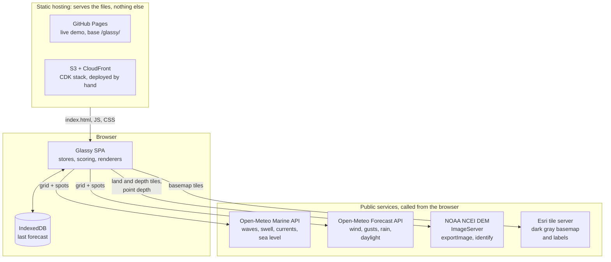
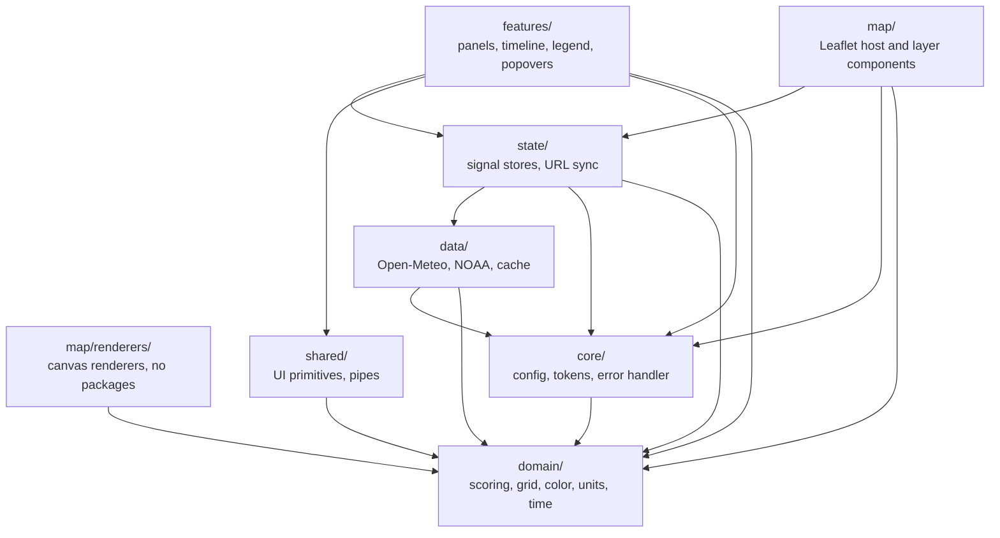
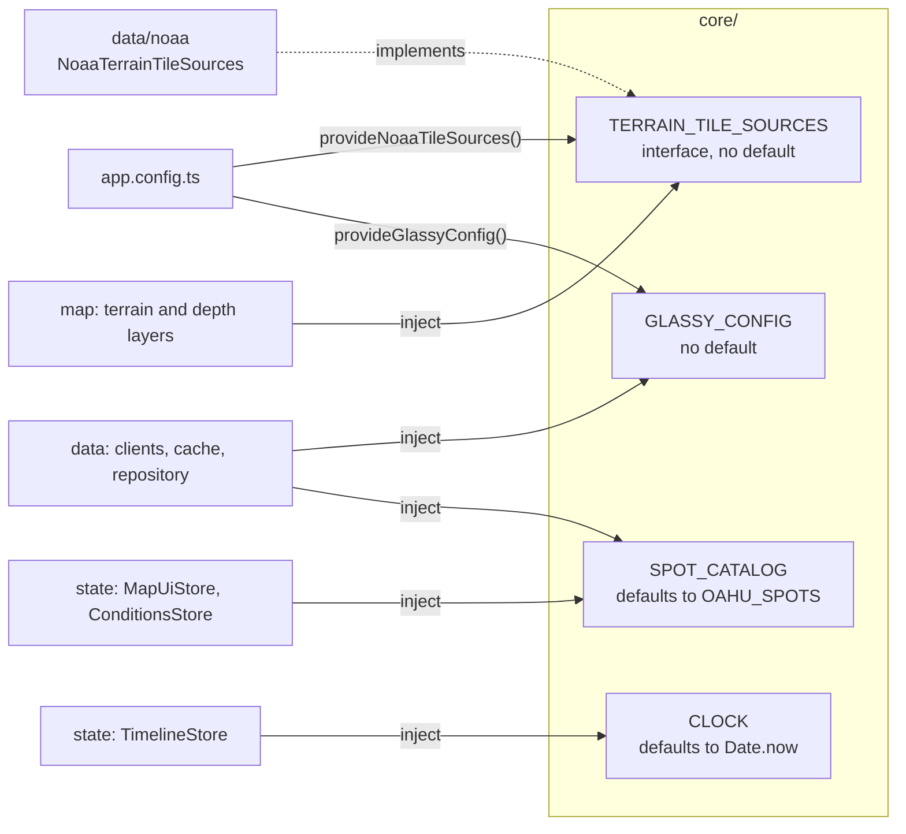
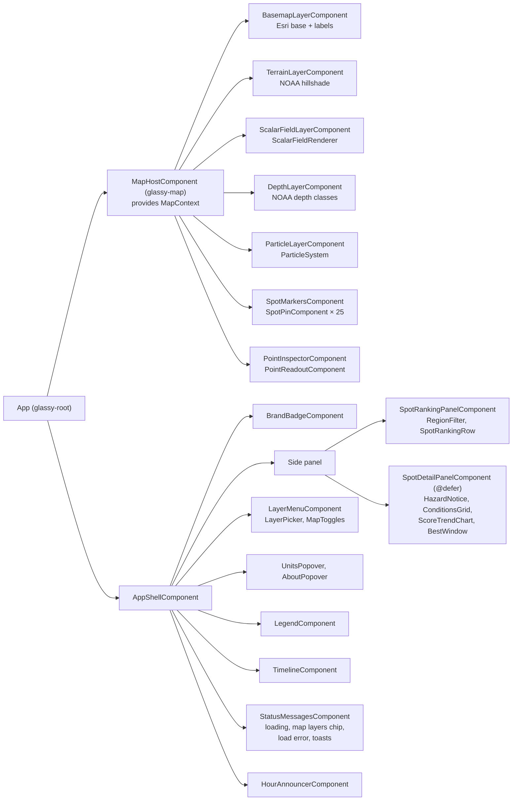
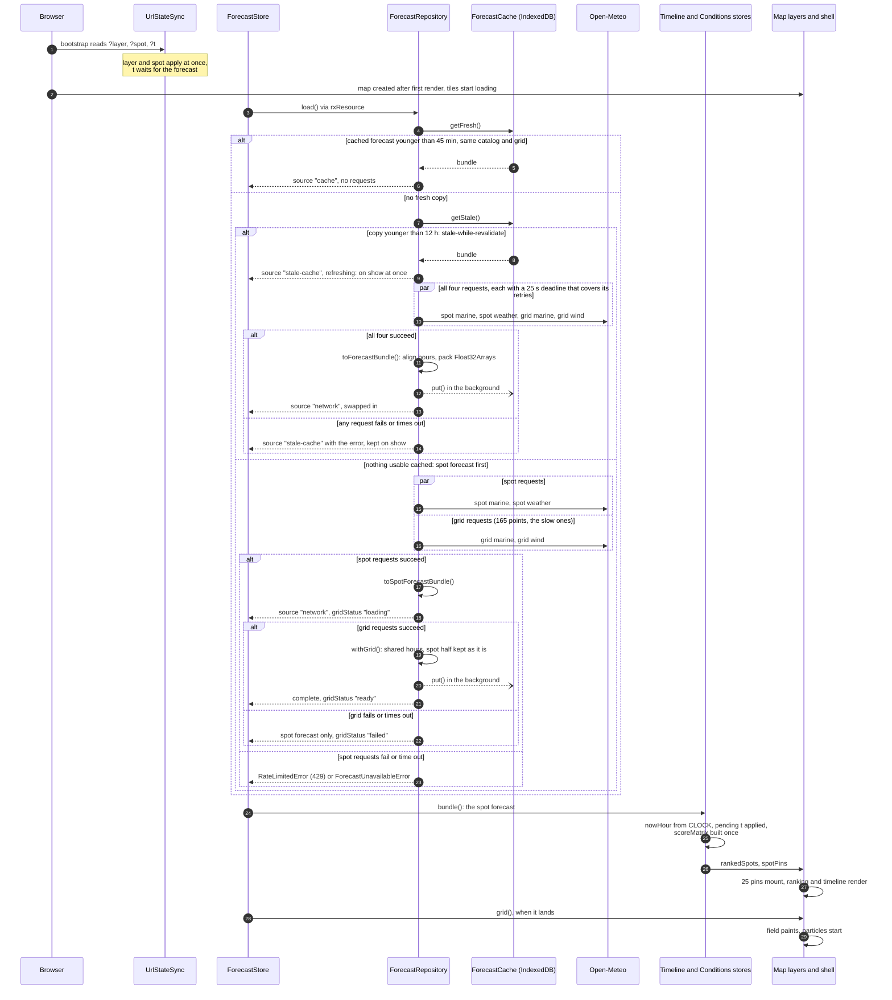
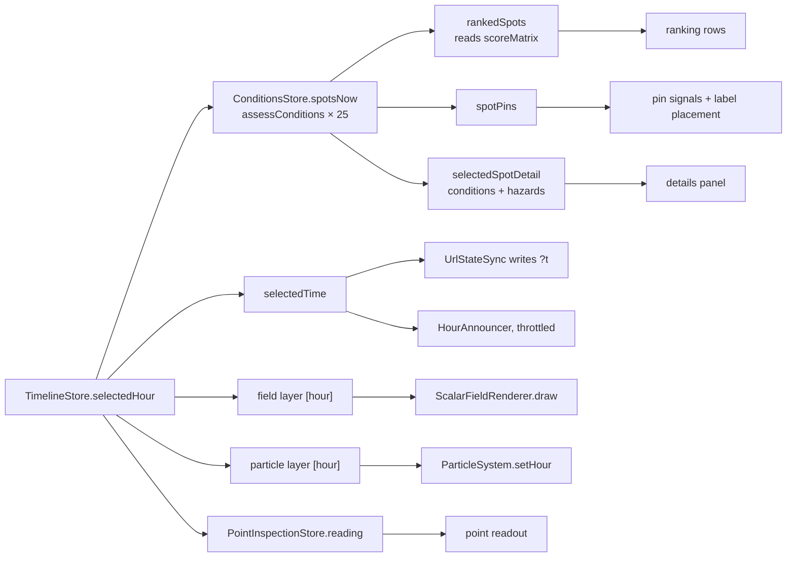
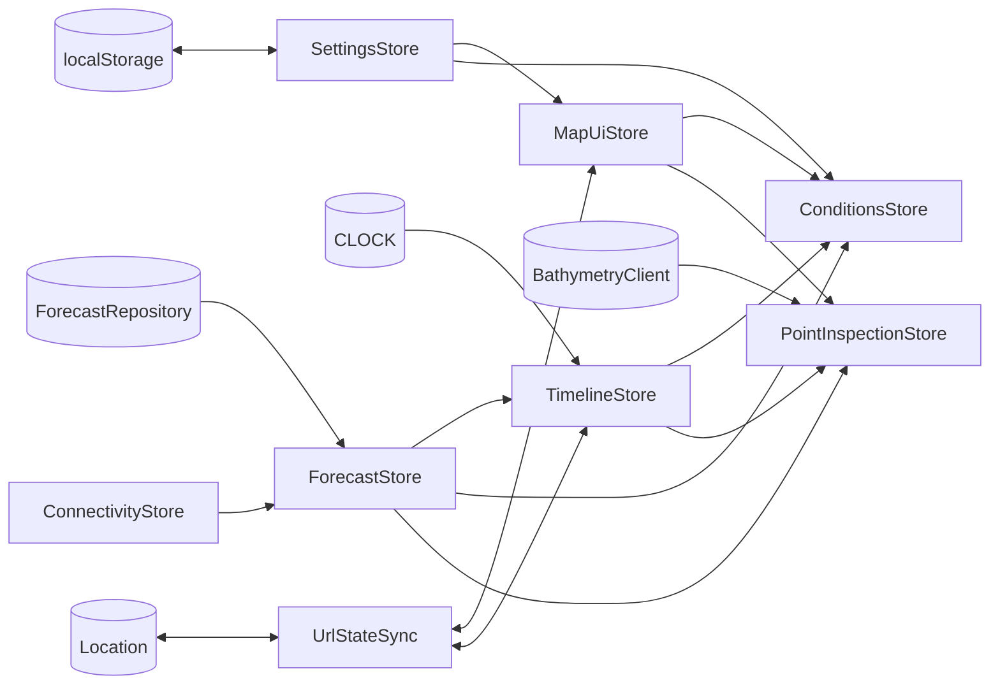

# Architecture

Glassy is a static Angular single-page app. Everything runs in the browser: it fetches the forecast
from Open-Meteo, scores every spot for every hour, and draws the map with Leaflet and its own canvas
renderers. There is no backend (see [ADR-0001](adr/0001-static-spa-no-backend.md)).

This page walks through the system from the outside in. Each layer's own README in `src/app/<layer>/`
has the detail.

- [System context](#system-context)
- [Layers and dependency rules](#layers-and-dependency-rules)
- [Component tree](#component-tree)
- [Startup sequence](#startup-sequence)
- [When the hour changes](#when-the-hour-changes)
- [State map](#state-map)
- [Rendering pipeline](#rendering-pipeline)

## System context

- **Hosting** only serves files. GitHub Pages runs the live demo; the AWS stack in `infra/` is
  ready to deploy (see [deployment.md](deployment.md)).
- **Open-Meteo** answers four requests per load: marine and wind on the 1/8° grid around Oahu (165
  cells, for the map layers), marine values 6 km offshore of each spot, and weather at each spot
  (for the score). When a fresh forecast is cached, none are sent; the spot requests are small and
  fast, the grid requests large and sometimes slow, so the spots render first.
- **NOAA NCEI's DEM mosaic** renders the land hillshade and the depth classes on request
  (`exportImage` with a raster function), and returns the elevation at a tapped point (`identify`).
- **Esri** provides the dark gray canvas basemap under the forecast colors and its place names
  above them.

The production Content-Security-Policy allows exactly these hosts
([`infra/lib/content-security-policy.ts`](../infra/lib/content-security-policy.ts)).

### Packages in the repository

[ADR-0010](adr/0010-backend-forecast-snapshot.md) moves the Open-Meteo requests out of the browser.
The diagram above shows the app as it still works today; #40 switches it to the snapshot.

| Folder     | What it is                                                                                                                                                    |
| ---------- | ------------------------------------------------------------------------------------------------------------------------------------------------------------- |
| `src/`     | The app, scoring included. It may not import from `backend/`.                                                                                                 |
| `backend/` | The forecast ingest: everything Open-Meteo, building `forecast.json`, and the Lambda handler that publishes it every 3 hours ([README](../backend/README.md)) |
| `shared/`  | The snapshot contract both use, imported as `@glassy/shared` ([README](../shared/README.md))                                                                  |
| `infra/`   | The AWS CDK stack: site hosting, and the scheduled ingest with its alarm ([README](../infra/README.md))                                                       |

ESLint enforces the boundaries between them, next to the layer rules below.

## Layers and dependency rules

`src/app/` is split into seven layers. ESLint (`eslint.config.js`) fails the build when a file
imports from a layer it is not allowed to use:

| Layer           | May import                          | Holds                                                                                  |
| --------------- | ----------------------------------- | -------------------------------------------------------------------------------------- |
| `domain`        | nothing (no packages at all)        | the scoring model, grid sampling, palettes, units, time, the spot catalog              |
| `core`          | `domain`                            | `GLASSY_CONFIG`, `SPOT_CATALOG`, `CLOCK`, `TERRAIN_TILE_SOURCES`, `AppNotices`, errors |
| `data`          | `domain`, `core`                    | Open-Meteo and NOAA clients, the adapter to typed arrays, the IndexedDB cache          |
| `state`         | `domain`, `data`, `core`            | the signal stores and URL sync                                                         |
| `map`           | `domain`, `state`, `core`           | the Leaflet host, layer components, spot pins, the point readout                       |
| `map/renderers` | `domain` only, and no packages      | `ScalarFieldRenderer`, `ParticleSystem` and the pure math they run on                  |
| `shared`        | `domain`                            | icons, rating badge, panel, popover, choice groups, unit pipes                         |
| `features`      | `domain`, `state`, `shared`, `core` | the shell, ranking, spot details, timeline, layer menu, legend, popovers, notices      |

Two things sit outside the layers: the root `App` component (`app.ts`), which puts the map and the
feature shell side by side, and `app.config.ts`, which wires the providers. Neither `map` nor
`features` imports the other; they meet only through the stores.

### Inverting dependencies through `core` tokens

Some lower layers need something a higher or sideways layer owns. Instead of breaking a rule, the
dependency points at an interface or token in `core/`, and `app.config.ts` (or a test) supplies it:

- **`TERRAIN_TILE_SOURCES`**: the map needs NOAA tile URLs but may not import `data/`. The map
  depends on the interface; `data/noaa/` implements it with its `exportImage` URL builder and
  raster rules.
- **`GLASSY_CONFIG`**: API base URLs, the grid, forecast days, time zone, cache lifetimes and the
  forecast request timeout. It has no default, so an app or test that forgets to provide it fails at injection time instead of
  calling the live APIs.
- **`SPOT_CATALOG`**: the 25 Oahu spots by default. Another island would provide its own catalog.
- **`CLOCK`**: "now" comes from this token, never `Date.now()`, so tests and the end-to-end suite
  pin the forecast hour.

`AppNotices` and `PREFERS_REDUCED_MOTION` in `core/` work the same way: the map reports tile
outages to `AppNotices` and the shell shows them, without either importing the other.

## Component tree

The root template (`src/app/app.html`) binds each map layer to the stores, for example
`<glassy-scalar-field-layer [field]="field()" [grid]="grid()" [palette]="palette()" [hour]="hour()" />`.
The shell comes first in the page, so Tab and screen readers reach the panels before the map.

- **`MapContext`** is provided by the host and injected by each layer. It carries the Leaflet map
  and three signals (`viewport`, `moving`, `zooming`), so a layer reacts in an `effect()` instead of
  subscribing to Leaflet events. Each layer adds itself to the map when it is created and removes
  itself when it is destroyed (`keepLayerOnMap`).
- **Pins and the readout are Angular components** mounted into Leaflet's DOM with
  `createComponent`, so they use the same pipes, inputs and tests as everything else.
- **Containers and presentational components.** A few feature containers inject the stores: the
  shell, ranking, details, timeline, layer menu, Units popover, status messages and hour announcer
  (marked in [`features/README.md`](../src/app/features/README.md)). Everything else takes
  `input()`s and reports through `output()`s.
- **`@defer`** keeps the spot details (18 kB) and the About text (1.8 kB) out of the initial
  bundle. Both prefetch when the browser is idle.

## Startup sequence

- **Something on screen as early as possible.** A fresh cached forecast is used as it is. A stale
  one (up to 12 hours old) shows at once while all four requests refresh it in the background, and
  is replaced only by a complete forecast, so the ranking and the map always come from the same
  fetch. With nothing cached, the spot forecast renders as soon as its two requests land, and the
  map grid, whose 165-point wind request has taken Open-Meteo a minute, fills in after it.
- **Timeouts.** Each request has one 25 s deadline (`forecastRequestTimeoutMs` in `GLASSY_CONFIG`)
  that covers its retries (after 1 s and 2 s, on network errors and 5xx), so retries never stack on
  top of it. The requests run in parallel, so no load waits on the network for longer than 25 s. A
  timeout is a `ForecastTimeoutError` and is never retried: a slow upstream only gets slower when
  asked twice.
- **The grid's arrival moves nothing.** `withGrid` keeps the spot half of the forecast when the
  grid shares its hours (the usual case), and `ForecastStore.bundle` only changes when the spot
  data does, so the scores, ranking and selected hour stay put. If the complete forecast ends up on
  fewer hours, `TimelineStore` keeps the selected hour by its time. Only complete forecasts are
  cached.
- **Status** comes out of `ForecastStore` as `loading` (also while a stale forecast is on show and
  being refreshed), `ready`, `stale` or `error`, with `gridStatus` (`loading`, `ready`, `failed`)
  for the map grid. `StatusMessagesComponent` turns them into the loading overlay, the "Loading map
  layers…" chip, the load error dialog or a toast ("Map overlay unavailable" when the grid failed).
- **The last forecast stays on screen** while a reload runs and after one fails. The store keeps the
  last result in its own signal, because a resource drops its value when a new request starts.
- **Back online.** `ConnectivityStore` follows the browser's `online` and `offline` events; when the
  connection returns after an error, while stale data is showing, or without the map grid, the
  store reloads by itself.
- **The cache fingerprint.** Each cached record keeps the spot ids in order and the grid it was
  fetched for. A record for a different catalog or grid is a miss, fresh or stale, because its
  per-spot series would no longer line up ([ADR-0005](adr/0005-indexeddb-forecast-cache.md)).

## When the hour changes

Scrubbing the timeline, pressing ← or →, clicking the score chart, playback (one hour every 450 ms)
and a shared link's `t` all end in `TimelineStore.seek()` or a step, which sets `selectedHour`.

| What                    | Work done for a new hour                                                                     |
| ----------------------- | -------------------------------------------------------------------------------------------- |
| Score matrix            | none: built once per forecast; the ranking reads the new hour's column                       |
| Spots at the hour       | `assessConditions` for each of the 25 spots, once, shared by the ranking, pins and details   |
| Selected spot's trend   | none: the trend and best window depend only on the forecast and the selection                |
| Scalar field            | one repaint of the 1/3-resolution canvas (skipped while the map is zooming)                  |
| Particles               | the vectors under the running particles are swapped; the animation does not restart          |
| Spot pins               | each pin's input signal is set and labels are placed again; no DOM is rebuilt                |
| Point readout           | the grid is sampled at the point for the new hour; the depth lookup is not repeated          |
| URL                     | `?t=YYYY-MM-DDTHH` is replaced in place (no new history entry); omitted for the current hour |
| Screen readers          | the new hour and best spot, at most once a second by hand and once every 5 s in playback     |
| Basemap, terrain, depth | nothing: they do not depend on time                                                          |

A Phase 6 trace confirmed it: twenty hours of playback repainted the field 20 times, and idling for
3 s repainted nothing.

Moving the map is the other trigger: `moveend` replaces `MapContext.viewport`, which repaints the
field, restarts the particles and places the labels again.

## State map

All state is in small signal stores (`@Injectable({ providedIn: 'root' })`) with private writable
signals and a read-only public surface ([ADR-0003](adr/0003-signal-stores-over-ngrx.md)). RxJS
appears only where the stores meet the repository and the NOAA client (`rxResource`).

| Store                  | Owns                                                      | Derives                                                                                   | Read by                                                 |
| ---------------------- | --------------------------------------------------------- | ----------------------------------------------------------------------------------------- | ------------------------------------------------------- |
| `ForecastStore`        | the load request, the last loaded result                  | `status`, `bundle`, `grid`, `gridStatus`, `fetchedAt`, `source`, `error`, `isRateLimited` | every other store, map layers, status messages          |
| `ConnectivityStore`    | whether the browser is online                             | `online`                                                                                  | `ForecastStore`, offline notices                        |
| `SettingsStore`        | units and map choices, saved to localStorage              | `units`, `mapPreferences`                                                                 | `MapUiStore`, `ConditionsStore`, Units popover, pipes   |
| `MapUiStore`           | selected and hovered spot, region filter, inspected point | `activeLayer`, `particlesOn`, `spotsOn`, `isDepth`, field and vector keys                 | map layers, controls, panels, `UrlStateSync`            |
| `TimelineStore`        | selected hour, playback                                   | `nowHour`, `selectedTime`, `isDaylight`, `days`, `nights`, `nowPosition`                  | timeline, map layers, `ConditionsStore`, `UrlStateSync` |
| `ConditionsStore`      | nothing                                                   | `scoreMatrix`, `rankedSpots`, `spotPins`, `selectedSpotDetail`, `legendSpec`              | ranking, details and chart, pins, legend                |
| `PointInspectionStore` | the depth lookup for the tapped point (`rxResource`)      | `elevation`, `forecast`, `reading`                                                        | the point readout                                       |
| `UrlStateSync`         | a `t` waiting for the forecast                            | `?layer=&spot=&t=` in both directions                                                     | started from `app.config.ts`                            |

- **One owner for preferences.** `SettingsStore` owns the units and the map choices (layer,
  particles, spots) in one validated, versioned record. `MapUiStore` exposes them as `computed`s and
  writes through `SettingsStore`, so there are no copies to drift apart.
- **Business rules stay in `domain/`.** The stores decide which inputs go to the domain functions
  and when; they compute no scores, ratings or hazards themselves.
- **No router.** `UrlStateSync` reads and writes the query string through `Location`
  ([ADR-0008](adr/0008-url-state-without-the-router.md)).

## Rendering pipeline

The map's moving parts are drawn by two framework-free classes in `map/renderers/`. They take a
canvas, plain arrays and a `MapView` (size, origin and a screen-to-coordinates callback), never
Angular or Leaflet. ESLint keeps every package out of that folder.

### The scalar field

- **1/3 resolution.** `ScalarFieldRenderer` paints one canvas pixel per 3 × 3 CSS pixels and lets
  the browser upscale it. The forecast grid is 1/8° (about 14 km), so full resolution would paint
  the same smooth gradient nine times slower.
- **Separable projection.** In Web Mercator, latitude depends only on the screen row and longitude
  only on the column, so `buildViewportLookup` projects `width + height` positions rather than one
  per pixel: a grid row for every canvas row and a grid column for every canvas column.
- **Bilinear sampling and a color table.** `paintField` interpolates the grid for the hour and maps
  each value through a 512-entry color lookup table built from the layer's palette (`buildLut`). It
  writes into one reused `ImageData` and fades the field out past the edge of the grid.
- **On demand.** It redraws on `moveend`, a new hour, field or palette, and hides while Leaflet
  animates a zoom.

### The particle system

- **Trails without history.** Each `requestAnimationFrame` keeps a share of the previous frame and
  adds one short segment per particle, so motion turns into trails without storing any.
- **Fixed density.** The particle count follows the map's area in CSS pixels, capped at 5,000, and
  the canvas is capped at 2× pixel density.
- **No per-frame allocation.** Particles are created once per start and reused: `advect` moves each
  one through the vector field, and one that leaves the view or reaches the end of its 50 to 110
  frame lifetime is respawned in place.
- **Stops when it should.** It stops while the map moves (every screen position goes stale), pauses
  while the page is hidden, and never starts when the user prefers reduced motion. A new hour only
  swaps the vectors.

### Label decluttering

Spot labels are placed by `placeLabels` in `domain/geo/label-declutter.ts`, a pure function with
its own tests. Labels claim space in priority order (the selected spot first, then the best scores)
and each takes the widest form that fits: surf and name (from zoom 11.25), surf only, or a dot.
Widths are estimated from text length, so placement needs no DOM measurement.

### Why framework-free

- They are tested as plain classes with a fake 2D context and animation host, without Leaflet,
  TestBed or a browser.
- They could move to a Web Worker with `OffscreenCanvas` unchanged (backlog
  [#12](https://github.com/jamesablue/glassy/issues/12)). At today's numbers it would buy little: a
  pan's redraw is under 10 ms of script.
- With zoneless change detection, an animation frame writes no signals and so triggers no change
  detection. Angular only runs when an input (hour, field, viewport) actually changes.
