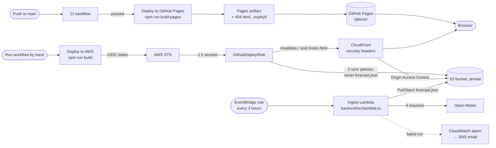

# Deployment

Glassy is a folder of static files, so it can be hosted anywhere that serves files. Two targets are
set up ([ADR-0007](adr/0007-dual-hosting-pages-and-aws.md)):

| Target              | URL                                                                 | Deploys                                  | Build configuration             |
| ------------------- | ------------------------------------------------------------------- | ---------------------------------------- | ------------------------------- |
| GitHub Pages        | [jamesablue.github.io/glassy](https://jamesablue.github.io/glassy/) | automatically, after CI passes on `main` | `github-pages`, base `/glassy/` |
| AWS S3 + CloudFront | the distribution's domain, or a custom domain                       | by hand, from the Actions tab            | `production`, base `/`          |

## Build configurations

Both live in `angular.json` and share the same bundle budgets (initial: warning at 510 kB, error at
535 kB; any component style: 2.3 kB and 3 kB).

- **`production`** (`npm run build`): base href `/`, every file name hashed, and critical CSS
  inlining switched off. Inlining adds an inline `<script>` to load the stylesheet, which the AWS
  Content-Security-Policy (`script-src 'self'`) would block. The AWS workflow fails if an inline
  script or event handler appears in `index.html`.
- **`github-pages`** (`npm run build:pages`): the same build with base href `/glassy/`, because
  Pages serves the project under the repository's name.

The output is `dist/glassy/browser/`.

## GitHub Pages

The workflow is [`.github/workflows/deploy-pages.yml`](../.github/workflows/deploy-pages.yml).

**Trigger.** It runs when the CI workflow completes for a push to `main` (`workflow_run`), and
deploys only if that run passed, so a red build never reaches the site. It checks out the exact
commit CI tested. It can also be started by hand (`workflow_dispatch`) to redeploy. The build job
also checks that the CI run came from a push, since a pull request from a fork can come from a
branch called `main` too.

**Build job.**

1. `npm ci`, then `npm run build:pages`.
2. Checks that `index.html` has `<base href="/glassy/">`. Every asset URL is relative to it, so a
   wrong one would break the whole site.
3. Copies `index.html` to `404.html` and adds an empty `.nojekyll`, so Pages serves the files as
   they are.
4. Uploads the folder with `actions/upload-pages-artifact`.

**Deploy job.** `actions/deploy-pages` publishes the artifact to the `github-pages` environment.
The job asks only for `pages: write` and `id-token: write`, and a `pages` concurrency group runs one
deploy at a time without canceling one halfway. The job summary links the site, the commit and the
CI run.

**The 404 fallback.** Pages has no rewrite rules: a path without a file behind it gets `404.html`.
As a copy of `index.html`, that boots the app, and `UrlStateSync` replaces the unknown path with
`/glassy/` while keeping the query string. So
`https://jamesablue.github.io/glassy/some/old/path?spot=hanauma&layer=depth` opens Hanauma Bay on the
depth layer at `/glassy/?spot=hanauma&layer=depth`. (Pages still sends that first response with a
404 status, which browsers ignore for display.)

**One-time setup.** Settings → Pages → Build and deployment → Source: **GitHub Actions**. Pages
creates the `github-pages` environment, which lets only `main` deploy.

**Rolling back.** Revert the bad commit on `main`; CI and the deploy follow. To redeploy without a
new commit, run **Deploy to GitHub Pages** by hand from the Actions tab.

## AWS: S3 and CloudFront

The infrastructure is an AWS CDK v2 app in [`infra/`](../infra/), a separate package with its own
tests. CI runs those tests and `cdk synth` (with cdk-nag) on every pull request, without AWS
credentials. Nothing is deployed until someone does the one-time setup below.
[`infra/README.md`](../infra/README.md) is the full runbook.

### What the stack creates

`GlassyStaticSite`, in `us-east-1` by default:

- **S3 bucket.** All public access blocked, ACLs off, S3-managed encryption, TLS required, no
  website hosting. Kept when the stack is deleted, unless configured otherwise.
- **CloudFront distribution.** Reads the bucket through Origin Access Control. HTTPS only, HTTP/2
  and HTTP/3, `PriceClass_100`. 403 and 404 answers become `/index.html` with a 200, so deep links
  open the app.
- **Response headers.** HSTS (two years, preload), `X-Content-Type-Options: nosniff`,
  `X-Frame-Options: DENY`, `Referrer-Policy`, `Permissions-Policy` and a Content-Security-Policy:

  | Directive     | Allows                                                                                 |
  | ------------- | -------------------------------------------------------------------------------------- |
  | `default-src` | `'self'`                                                                               |
  | `script-src`  | `'self'` only: no inline scripts                                                       |
  | `style-src`   | `'self' 'unsafe-inline'` (Angular adds component styles at runtime)                    |
  | `img-src`     | `'self' data: blob:`, `server.arcgisonline.com`, `gis.ngdc.noaa.gov`                   |
  | `connect-src` | `'self'`, `marine-api.open-meteo.com`, `api.open-meteo.com`, `gis.ngdc.noaa.gov`       |
  | others        | `object-src 'none'`, `frame-ancestors 'none'`, `base-uri 'self'`, `form-action 'self'` |

  The host list is in one place, [`infra/lib/content-security-policy.ts`](../infra/lib/content-security-policy.ts).
  A new outside host has to be added there, or it works in `ng serve` and is blocked in production.

- **GitHub OIDC provider and deploy role.** Only jobs in the `production` environment of
  `jamesablue/glassy` can assume the role (`sub = repo:jamesablue/glassy:environment:production`).
  It can list the bucket, read, write and delete its objects, and create invalidations for (and
  read) this one distribution. No AWS keys are stored anywhere.
- **Optional custom domain.** An ACM certificate validated through DNS, plus Route 53 `A` and
  `AAAA` alias records.
- **Forecast ingest** ([ADR-0010](adr/0010-backend-forecast-snapshot.md)). An EventBridge rule
  runs a Lambda function (`backend/src/lambda.ts`) at a quarter past every third hour, UTC. It
  fetches Open-Meteo, validates the snapshot as the app will, and writes `forecast.json` to the
  bucket with `Cache-Control: public, max-age=300, stale-while-revalidate=3600`. Its role may write
  that one key and its own logs, nothing else. A failed run writes nothing, so the last good
  snapshot stays; the function retries once, and a CloudWatch alarm notifies an SNS topic (and
  `alarmEmail`, if set).
- **`/forecast.json` behavior.** The same caching and security headers as the rest of the site,
  plus `Access-Control-Allow-Origin: https://jamesablue.github.io`, so the Pages demo can read the
  snapshot from this domain.

Outputs: `BucketName`, `DistributionId`, `DistributionDomainName`, `DeployRoleArn`,
`IngestFunctionName`, `IngestLogGroupName`, `IngestAlarmName`, `IngestAlarmTopicArn`.

### Switching it on

Done once, with administrator credentials ([details](../infra/README.md#first-deployment)):

1. Bootstrap CDK in the account and region: `cd infra && npm ci && npx cdk bootstrap aws://<account-id>/us-east-1`.
2. Deploy the stack: `npx cdk deploy -c alarmEmail=<you@example.com>` (add
   `-c createOidcProvider=false` if the account already has a GitHub OIDC provider), and confirm
   the subscription from the email AWS sends.
3. Create a `production` environment in the repository (Settings → Environments), limited to
   `main`, optionally with a required reviewer.
4. Add the repository variables (Settings → Secrets and variables → Actions → Variables). They are
   not secrets:

   | Variable                     | Value                   |
   | ---------------------------- | ----------------------- |
   | `AWS_ROLE_ARN`               | `DeployRoleArn` output  |
   | `AWS_REGION`                 | `us-east-1`             |
   | `S3_BUCKET`                  | `BucketName` output     |
   | `CLOUDFRONT_DISTRIBUTION_ID` | `DistributionId` output |

5. Publish the first snapshot instead of waiting for the schedule:
   `aws lambda invoke --function-name <IngestFunctionName> /dev/stdout`. Then check
   `https://<domain>/forecast.json` (its `fetchedAt`, and the CORS header) and the alarm state, as
   in [Checking the ingest](../infra/README.md#checking-the-ingest). The backend must be publishing
   before an app that reads the snapshot ships (#40).

### Deploying

Actions → **Deploy to AWS** → **Run workflow**, or `gh workflow run deploy-aws.yml --ref main`.
[`deploy-aws.yml`](../.github/workflows/deploy-aws.yml) then:

1. stops at once if a repository variable is missing;
2. builds the `production` configuration and checks `index.html` for inline scripts;
3. signs in to AWS through OIDC for a one-hour session;
4. uploads in three passes, each with its own cache lifetime: hashed bundles (`max-age=31536000,
immutable`), the files from `public/` (`max-age=3600`), and finally `index.html` (`no-cache`), so
   it never points at bundles that are not there yet. `forecast.json` is excluded, so the syncs'
   `--delete` never removes the ingest's snapshot;
5. invalidates `/` and `/index.html` in CloudFront and writes the site URL to the job summary.

**Rolling back.** Run the workflow again with the `ref` input set to the last good tag or commit.
Hashed bundles from earlier builds are pruned by each sync's `--delete`, so a rollback rebuilds
rather than restoring old files.

### Running cost

An estimate at us-east-1 list prices, for one month at demo traffic. It assumes a run takes about
15 seconds; replace that with the `Duration` from the function's `REPORT` log lines after the first
deploy.

| Item                    | Usage per month                                                 | Always-free allowance        | Cost beyond it   |
| ----------------------- | --------------------------------------------------------------- | ---------------------------- | ---------------- |
| Lambda (arm64, 512 MB)  | 240 runs × ~15 s × 0.5 GB ≈ 1,800 GB-s, 240 requests            | 400,000 GB-s, 1 M requests   | ≈ $0.03          |
| EventBridge rule        | 240 scheduled events                                            | scheduled rules are free     | $0               |
| S3 writes               | 240 `PutObject` at $0.005 per 1,000                             | none                         | ≈ $0.001         |
| S3 reads and storage    | CloudFront revalidates every 5 min per busy edge; < 1 MB stored | none                         | < $0.05          |
| CloudWatch alarm        | 1 standard alarm                                                | 10 alarms                    | $0.10            |
| SNS email notifications | a few, only when runs fail or recover                           | 1,000 emails                 | $0               |
| CloudWatch Logs         | a few lines a run, < 1 MB, kept a month                         | 5 GB                         | < $0.01          |
| CloudFront              | ~100 kB per forecast load, plus the app                         | 1 TB out, 10 M requests      | about $0.09 a GB |
| **Total**               |                                                                 | **about $0.05 a month paid** | **< $0.20**      |

With the always-free allowances, only S3 requests are paid, a few cents. Without them, the ingest
and its alarm come to under $0.20. Both are well under the $1 a month ADR-0010 expected. S3's own
free tier is not counted: it lasts 12 months and only for accounts opened before July 2025.

The ingest's traffic is fixed: about 388 weighted Open-Meteo calls a run, 3,100 a day (31% of the
free limit), however many people visit. What would raise the bill is visitors, through CloudFront
beyond its free terabyte, not the ingest.

**Custom domain and teardown** are covered in [`infra/README.md`](../infra/README.md#custom-domain).
The bucket is retained by default when the stack is destroyed.
