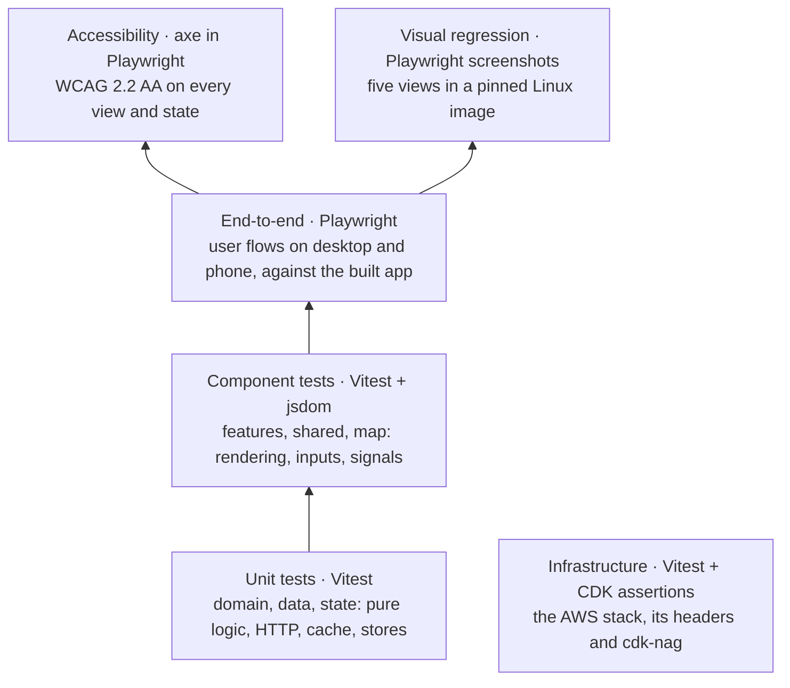
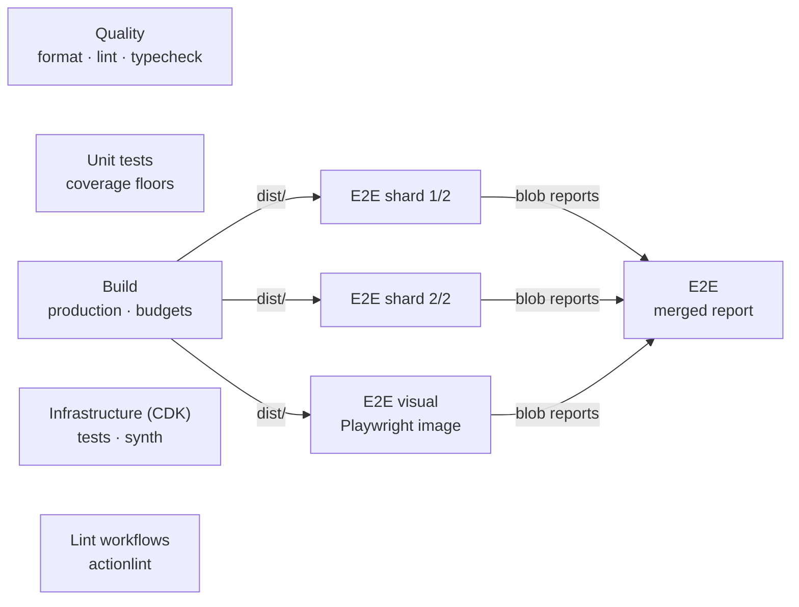

# Testing

Glassy is tested at five levels, each catching what the one below cannot. Most tests are fast unit
tests of pure logic; fewer, slower tests drive the real app in a browser. Everything runs offline
against one recorded forecast, so a run on any day gives the same result.



| Level          | Tool                              | Where                                           | Run with                                 |
| -------------- | --------------------------------- | ----------------------------------------------- | ---------------------------------------- |
| Unit           | Vitest                            | `src/app/{domain,data,state,core}/**/*.spec.ts` | `npm test`, `npm run test:ci` (coverage) |
| Component      | Vitest, Angular TestBed, jsdom    | `src/app/{features,shared,map}/**/*.spec.ts`    | the same                                 |
| End-to-end     | Playwright (Chromium)             | `e2e/*.spec.ts`                                 | `npm run e2e`                            |
| Accessibility  | axe-core in Playwright            | `e2e/a11y.spec.ts`                              | `npm run e2e`                            |
| Visual         | Playwright `toHaveScreenshot`     | `e2e/visual.spec.ts`                            | `npm run e2e:visual` (Docker)            |
| Infrastructure | Vitest, CDK `Template` assertions | `infra/test/`                                   | `cd infra && npm test`                   |

## Unit and component tests

Vitest runs through Angular's unit-test builder (`ng test`) in jsdom. The layers are tested in the
way that suits them:

- **`domain/`**: plain functions with no Angular or browser code: scoring, grid sampling, colour
  scales, units, geometry, time. Tested directly, including edge cases such as bilinear sampling at
  the grid's border and every row of the penalty tables.
- **`data/`**: the Open-Meteo and NOAA clients against Angular's HTTP testing backend, the adapter
  that packs responses into typed arrays, and the IndexedDB cache on `fake-indexeddb` (lifetime,
  stale fallback, records from an older app, storage failures).
- **`state/`**: the signal stores with their real dependencies where possible: loading and retries,
  playback, URL sync in both directions, saved settings.
- **`map/`**: the framework-free canvas renderers with stub canvases, and the Leaflet layer
  components in a host map. jsdom has no layout or real canvas, so what needs pixels is left to
  Playwright.
- **`features/` and `shared/`**: components rendered with TestBed against the recorded forecast,
  queried by role and text as a user would see them: the ranking sorts and filters, the timeline
  steps from the keyboard, the units change the text, the detail panel shows hazards.

### Coverage floors

`npm run test:ci` fails when a layer's coverage (statements, branches, functions and lines) drops
below its floor. The floors live in `vitest-base.config.mts`:

| Layer       | Floor | Why                                                                                                              |
| ----------- | ----: | ---------------------------------------------------------------------------------------------------------------- |
| `domain/`   |   95% | Pure logic with no framework: everything is reachable from a test, and a scoring mistake is the most costly bug. |
| `data/`     |   90% | HTTP, caching and parsing failures hide in error branches, which are easy to skip.                               |
| `state/`    |   90% | Loading, playback and URL sync interleave; the stores are where those orders are decided.                        |
| `shared/`   |   90% | Small UI primitives and pipes used everywhere, so held close to the domain's bar.                                |
| `features/` |   85% | Tested through the DOM; layout, real pointer input and the browser's popovers are left to Playwright.            |
| `map/`      |   80% | Drives Leaflet and canvases, which jsdom only partly emulates; Playwright covers the rest in a real browser.     |

The floors sit below today's numbers (99% overall), so they catch a drop without blocking a small,
well-tested change. In CI the `Unit tests` job writes each layer's coverage next to its floor to the
job summary and uploads the HTML report as the `coverage-report` artifact.

### The golden parity test

Glassy was ported from a prototype, and its scoring model had to come across unchanged.
`src/app/domain/scoring/golden.spec.ts` checks every spot and every hour of a real recorded forecast
against the numbers the prototype's own code produces:

- `src/testing/fixtures/spot-forecast.fixture.json` holds each spot's hourly series from one
  recording of the Open-Meteo APIs.
- `src/testing/fixtures/spot-forecast.expected.json` holds the score, surf height and ranking for
  each hour, computed by `scripts/generate-expected-scores.mjs`, which keeps a verbatim copy of the
  prototype's scoring code and imports nothing from `src/app`.
- The test scores the same data with the TypeScript port and allows a difference of 1e-6.

The end-to-end tests read the same expected rankings, so the ranking on screen is checked against
the prototype too. If the scoring model changes on purpose, change the copy in
`generate-expected-scores.mjs` to match and regenerate, so the change shows up as a reviewable diff
in the expected values.

### Re-recording the fixtures

The unit tests, the golden test and the end-to-end network mocks all use one recording, so they
describe the same forecast:

```sh
npm run fixtures:record    # scripts/record-fixtures.ts: needs network access to Open-Meteo and NOAA
npm run fixtures:expected  # scripts/generate-expected-scores.mjs: re-scores with the prototype's code
```

Record again when the app's requests change; `open-meteo.adapter.fixtures.spec.ts` fails when the
configuration or the spot catalog no longer matches the recording. A new recording moves the dates,
so the end-to-end clock and expected texts and the screenshot baselines need updating too
([e2e/README.md](../e2e/README.md#adding-or-updating-a-fixture)).
[src/testing/fixtures/README.md](../src/testing/fixtures/README.md) lists every file.

## End-to-end tests

Playwright drives the app in Chromium as a desktop (`chromium` project) and as a Pixel 7 (`mobile`
project): loading and ranking, the spot details, the timeline, layers and legend, popovers, shared
links, the phone layout, keyboard use, reduced motion, and the error, stale, offline and tile
failure states.

Every spec takes `test` from `e2e/support/test.ts`, which serves the recorded Open-Meteo and NOAA
responses, answers map tiles with a blank image, aborts any other outside request and pins the clock
to the morning of the recording. Locally the tests run against `ng serve`; in CI against the
production build, served by a small static server. [e2e/README.md](../e2e/README.md) covers the
support code, the mocking and how to add a fixture.

### Accessibility

`e2e/a11y.spec.ts` runs axe on the ranking, the spot details, both popovers, the depth layer, the
point readout, the load error screen, the error toast and the stale forecast notice. Any violation
of WCAG 2.0, 2.1 and 2.2 at levels A and AA, or of axe's best practices, fails the test. The one
exception (target size for overlapping map pins) is documented in `e2e/support/axe.ts`.
`keyboard.spec.ts` and `reduced-motion.spec.ts` cover what axe cannot see: focus order, focus
return and motion.

### Visual regression

`e2e/visual.spec.ts` compares five views with committed screenshots: the ranking, Hanauma Bay's
details, the depth layer, the Units popover and the ranking on a phone. Reduced motion stops the
particles and map flights, and the recorded data, blank tiles and pinned clock do the rest, so each
run draws the same pixels; up to 1% of pixels may differ, for anti-aliasing.

The app uses system fonts, so screenshots only match in the environment the baselines were taken
in. That is the Playwright Linux image for the installed Playwright version: `npm run e2e:visual`
runs the comparison there through Docker, and `npm run e2e:visual:update` takes new baselines.
CI uses the same image. A manual **Update screenshots** workflow takes new baselines on GitHub for
anyone without Docker.

## Infrastructure tests

The AWS CDK app in `infra/` has its own Vitest suite. It asserts on the synthesized CloudFormation:
a private, encrypted bucket reached only through CloudFront, errors routed to `index.html`, the
security headers and Content-Security-Policy, a deploy role limited to what the deploy workflow
needs, and a clean cdk-nag report. `npm run synth` in CI also fails on any
unacknowledged cdk-nag finding.

## How CI runs it all

`.github/workflows/ci.yml` runs on every pull request and every push to `main`. Each check is its
own job, so independent checks run side by side:



| Job                    | What fails it                                                            | What it leaves                              |
| ---------------------- | ------------------------------------------------------------------------ | ------------------------------------------- |
| `Quality`              | Prettier, ESLint (including layer boundaries) or TypeScript              |                                             |
| `Unit tests`           | A failing test or a layer below its coverage floor                       | Coverage table in the summary; HTML report  |
| `Build`                | A build error or a bundle over budget (`angular.json`)                   | Chunk sizes in the summary; `dist/`         |
| `E2E shard 1/2`, `2/2` | A failing end-to-end or axe test, after one retry                        | Blob report (trace on the retry)            |
| `E2E visual`           | A screenshot more than 1% different                                      | Blob report with expected, actual and diff  |
| `E2E`                  | Any of the three jobs above                                              | One merged HTML report: `playwright-report` |
| `Infrastructure (CDK)` | Prettier, a failing stack test, or synth (type errors, cdk-nag findings) |                                             |
| `Lint workflows`       | actionlint (and shellcheck) on every workflow, including manual ones     |                                             |

The end-to-end jobs reuse the `Build` job's output instead of building again, cache the Playwright
browser by version, and serve the built files, which starts faster than a dev server and tests what
ships. A new push to a pull request cancels the run for the previous one.

Two more workflows guard the repository: **CodeQL** analyses the TypeScript for security problems on
pull requests, on `main` and weekly, and **Dependency review** fails a pull request that brings in a
dependency with a high or critical advisory. Dependabot opens grouped update pull requests weekly.
