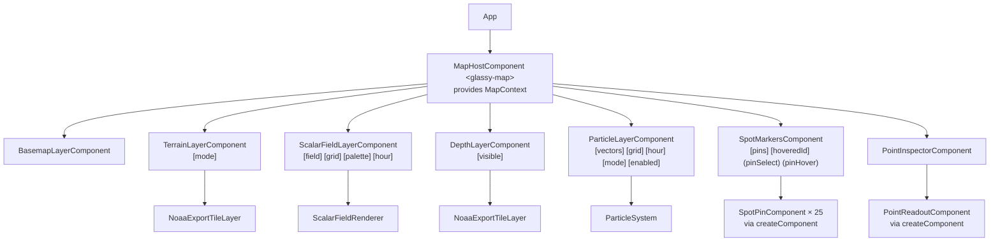

# map

The Leaflet map, built from Angular components.

**Lives here**

- `map-host/`: `MapHostComponent` (`<glassy-map>`) creates the map, its panes and controls, frames Oahu and
  shares a `MapContext` with the layer components projected into it
- `layers/`: one standalone component per layer (basemap, terrain, depth, scalar field, particles, spot
  markers, point inspector), plus the small Leaflet layer classes they use: `GuardedTileLayer`,
  `NoaaExportTileLayer` and `CanvasOverlay`, and `TileOutage`, which pauses a tile source that stops answering
- `renderers/`: the canvas renderers (`ScalarFieldRenderer`, `ParticleSystem`) and the pure math they run on
  (`buildViewportLookup`, `paintField`, `advect`)

## Component tree

The root `App` composes the tree and binds each layer to the stores (`MapUiStore`, `ForecastStore`,
`TimelineStore`, `ConditionsStore`). A map click goes to `MapUiStore.inspect`, a pin to `MapUiStore.selectSpot`,
and the pointer over a pin to `MapUiStore.hoverSpot`, which the ranking reads to highlight the spot's row; a
hovered row comes back the same way as `[hoveredId]`, which shows the pin's full label and raises it.

## How the pieces talk

- **`MapContext` through DI.** The host provides it; layers inject it. It carries the map and three signals,
  `viewport` (replaced after every move, zoom and resize), `moving` and `zooming`, so a layer reacts in an
  `effect()` instead of subscribing to Leaflet events and cleaning them up itself. Content children are
  created before the host renders, so `map` is a signal that starts `undefined`.
- **Layers own their lifecycle.** Each one builds its Leaflet layer in its constructor and calls
  `keepLayerOnMap(layer, shown?)`, which adds it once the map exists, follows `shown`, and removes it on destroy.
  Destroying the host removes the map and with it every layer, listener and animation frame.
- **Tile URLs come from `core/`.** `map/` may not import `data/`, so the terrain and depth layers ask the
  `TERRAIN_TILE_SOURCES` token for URLs. `data/noaa/` implements it with its `exportImage` builders and
  raster rules, and `app.config.ts` wires it with `provideNoaaTileSources()`.
- **Point elevation comes from `state/`.** The inspector reads `PointInspectionStore`, which looks the depth up
  through `BathymetryClient` and samples the forecast at the point for the selected hour.
- **Renderers are framework-free.** They take a canvas, plain arrays and a `MapView` (size, origin and a
  screen-to-coordinates callback), never Angular or Leaflet, so they can move into a Web Worker. ESLint enforces
  this for `renderers/`.

## When things go wrong

- **A tile source stops answering.** Each tile layer (Esri's basemap and place names, NOAA's land and depth)
  reports failed tiles to its own `TileOutage`. After six failures in a row the source is paused for 30 s: its
  layer shows blank tiles without asking, so a dead server neither fills the console with failed requests nor
  gets hit on every pan, and `AppNotices` (in `core/`) gets one `map-tiles-unavailable` notice however many
  sources fail. The forecast colours, particles and pins carry on; the next tiles after the pause try again.
- **A depth lookup fails.** The readout shows "—" with the reason as a tooltip (and after the dash for screen
  readers): no data at that point, or a failed lookup that tapping again retries.

## Keyboard, screen readers and motion

- **The map is the `main` landmark**, named "Forecast map", with a hidden hint about its keys. Focused, the
  arrows pan it, + and − zoom, and Enter inspects the point in the middle, marked by a ring, which is the
  keyboard's way to tap the sea. `MapHostComponent` marks the arrows as handled there, so the app-wide
  shortcuts leave them to Leaflet. Tab then goes through the pins and the zoom buttons, which all have focus rings.
- **Pins are at least 24 × 24 px.** Where the island is zoomed out, neighbouring pins on the North Shore still
  overlap; each spot is also a full-size row in the ranking, which is the equivalent control WCAG 2.5.8 allows.
- **Selecting a spot flies it into the part of the map the panels leave uncovered** (`panelInsets`), above the
  details sheet on a phone and right of the side panel on wider screens, and a pin that gets keyboard focus is
  panned clear of them too, so focus is never hidden behind a panel.
- **Reduced motion** (`PREFERS_REDUCED_MOTION` in `core/`): the map is created without Leaflet's zoom, fade and
  inertia animations, a selected spot is moved to at once instead of flown to, the field and land transitions
  are off, and the particles never start (`ParticleSystem` checks the same media query).

## When the hour changes

`TimelineStore.selectedHour` changes, and each input that depends on it updates:

| Layer                   | What happens                                                                                                   |
| ----------------------- | -------------------------------------------------------------------------------------------------------------- |
| Scalar field            | its `[hour]` changes; the effect repaints the canvas for the new hour (unless the map is zooming)              |
| Particles               | its `[hour]` changes; `ParticleSystem.setHour` swaps the vectors under the particles, no restart               |
| Spot markers            | `ConditionsStore.spotPins` recomputes; each pin's signal is set and labels are placed again                    |
| Point inspector         | `PointInspectionStore.reading` resamples the forecast; the readout re-renders and Leaflet re-centres the popup |
| Basemap, terrain, depth | nothing: they do not depend on time                                                                            |

Moving the map is the other trigger: `moveend` replaces `MapContext.viewport`, which repaints the field,
restarts the particles and places the labels again.

## Styling

Component styles cover what a component renders (`SpotPinComponent`, `PointReadoutComponent`, the host).
Leaflet builds its own DOM outside any component, so panes, land modes, controls, the popup frame and the marker
wrapper are styled in `src/styles/leaflet-overrides.scss`. Colours come from `src/styles/tokens.scss`.

**May import:** `domain/`, `state/`, plus config tokens from `core/` (and Angular and Leaflet). `renderers/` may
import only `domain/`.

**Must not import:** `data/`, `features/`, `shared/`.

**Tests:** renderers are tested as pure functions and with a fake 2D context and animation host
(`src/testing/fake-canvas.ts`, `fake-animation-host.ts`). Components run against real Leaflet in jsdom
(`src/testing/map-harness.ts`), which has no layout, so `resizeMap()` gives the map a size. Coverage below 80%
fails `npm run test:ci`; Playwright checks the rest in a real browser (`e2e/map.spec.ts`).
