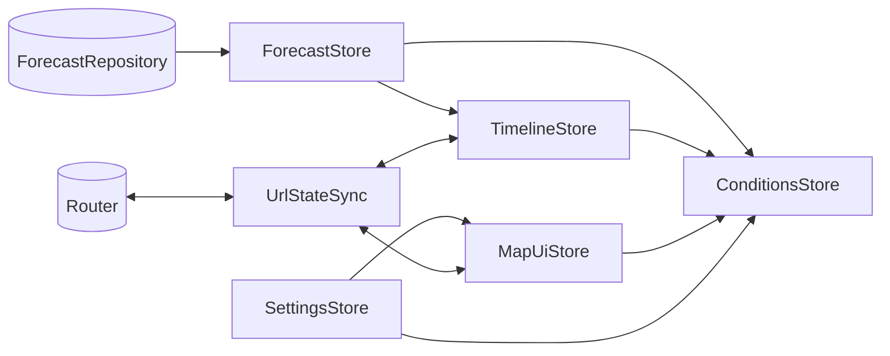

# state

Application state as small signal-based stores. Each store is an `@Injectable({ providedIn: 'root' })`
service with private writable signals, a read-only public surface (`asReadonly()` and `computed()`) and
methods named after what the user does. RxJS appears only where the stores meet the repository
(`rxResource`) and nothing here holds state in a `Subject`.

| Store             | Owns (writable)                                                       | Derives (`computed`)                                                                                     | Read by                                                        |
| ----------------- | --------------------------------------------------------------------- | -------------------------------------------------------------------------------------------------------- | -------------------------------------------------------------- |
| `ForecastStore`   | the load request; the last loaded `ForecastResult`                    | `status`, `bundle`, `fetchedAt`, `source`, `error`, `isRateLimited`                                      | every other store; loading overlay and notices                 |
| `SettingsStore`   | `Preferences`: units and map choices, saved to localStorage           | `units`, `mapPreferences`                                                                                | `MapUiStore`, `ConditionsStore`; units popover, unit pipes     |
| `MapUiStore`      | selected spot, region filter, inspected point                         | `activeLayer`, `particlesOn`, `spotsOn` (through `SettingsStore`), `selectedSpot`, `isDepth`, field keys | `ConditionsStore`, `UrlStateSync`; map layers, controls, panel |
| `TimelineStore`   | selected hour, playback                                               | `hourCount`, `nowHour`, `nowPosition`, `todayKey`, `selectedTime`, `days`, `nights`                      | `ConditionsStore`, `UrlStateSync`; timeline, map layers        |
| `ConditionsStore` | nothing                                                               | `scoreMatrix`, `rankedSpots`, `spotPins`, `selectedSpotDetail`, `legendSpec`                             | ranking, detail panel and chart, spot markers, legend          |
| `UrlStateSync`    | a `t` waiting for the forecast; whether the opening URL has been read | `?layer=&spot=&t=` in both directions (see its TSDoc for the format and rules)                           | started from `app.config.ts`                                   |

**Rules**

- Business rules (scores, ratings, hazards, ranking, the best window, legends, time) live in `domain/`;
  the stores only decide which inputs to feed them and when.
- Time comes from the `CLOCK` token in `core/`, never `Date.now()`, so "now" is controllable in tests.
- Anything read from outside (localStorage, URL parameters) is checked value by value with the helpers
  in `parse.ts`: an invalid value is treated as missing and never reaches a store.

**May import:** `domain/`, `data/`, plus config tokens from `core/`.

**Must not import:** `map/`, `features/`, `shared/`.

**Tests:** specs sit next to each store and go through its public API with `TestBed`, a fake
`ForecastRepository`, a fixed `CLOCK` and fake timers for playback. The ranking is checked against the
golden fixture. Coverage below 90% fails `npm run test:ci`.
